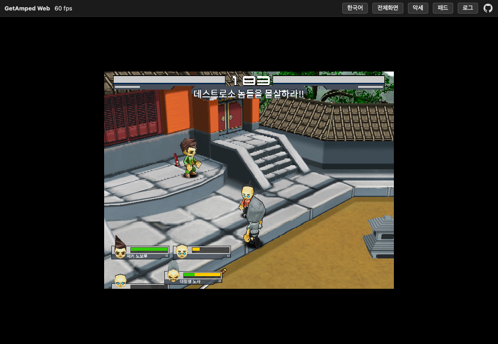

# GetAmped Web

2001년에 CD로 나온 싱글 겟앰프드(GetAmped 1.0.12, 외전 「下町の侵略者」)를 설치 없이 브라우저에서 돌립니다. 자바 클라이언트를 CheerpJ(브라우저용 JVM)로 실행하고 DLL이 하던 일을 자바와 자바스크립트로 다시 구현했습니다. 한글화와 커스텀 악세사리 제작 도구가 들어 있습니다.

**바로 플레이:** https://amped-web.vercel.app



## 할 수 있는 것

- 싱글 플레이
- 커스텀 악세사리 제작
- 모바일
- 한국어 / 일본어 전환

처음 열면 자바 런타임과 게임 데이터를 받느라 PC에서 20~30초 걸립니다. 모바일은 WebGL을 모바일 GPU로 돌리기 때문에 로딩이 더 느릴 수 있습니다.

## 조작

| 동작 | PC | 모바일 |
|---|---|---|
| 이동 / 대시 | 방향키 / 같은 방향 두 번 | 십자키 |
| 약공격 | C | C 버튼 |
| 강공격 | X | X 버튼 |
| 조준 (누른 채) | Z | Z 버튼 |
| 동시 입력 | Z+X, Z+C, X+C, Z+X+C | ZX, ZC, XC, ZXC 버튼 |
| 점프 / 메뉴 결정 | V | V 버튼 |
| 취소 | Esc | 없음 |

URL 파라미터

| 파라미터 | 뜻 |
|---|---|
| `lang=ko` / `ja` | 언어 |
| `accs=heavygloves` / `volcano` / `icegloves` | 스토리 캐릭터에 악세사리 장착. 상단 **악세** 버튼의 모아보기에서 골라도 됩니다 |
| `pad=1` / `0` | 가상 패드 강제 표시 / 숨김 |
| `debug=1` | 기술 판정 로그를 콘솔에 출력 |

## 만든 과정

1. **잠긴 클래스 풀기** — 원본 게임의 자바 클래스는 암호화되어 있고 실행할 때 DLL이 풀어 줍니다. 그 방식을 그대로 옮겨 빌드할 때 미리 풀어 둡니다.
2. **윈도우 전용 부품 바꿔 끼우기** — 그래픽, 창과 키 입력, 소리, 통신을 맡던 DLL 8개를 자바와 자바스크립트로 다시 만들었습니다. 옛날 OpenGL 그리기는 WebGL로 흉내 냅니다.
3. **글자** — 브라우저 JVM이 한글·한자를 못 그려서 글자는 브라우저가 대신 그려 줍니다.
4. **한글화** — 게임 안 문자열은 번역표로 바꾸고 그림에 박힌 글자는 그림을 다시 그렸습니다.
5. **악세사리 도구** — 텍스트 파일로 적으면 게임 형식으로 바꿔 주는 도구를 만들었습니다.
6. **배포** — 서버 없이 정적 파일만으로 돌아가게 해서 Vercel에 올렸습니다.

## 로컬 실행

`web/game/`에 빌드 결과물이 들어 있어 클론만 하면 됩니다. CheerpJ 규칙(Range, 디렉토리 목록)을 아는 서버가 필요해서 Rust 서버를 같이 넣었습니다.

```bash
git clone https://github.com/greekr4/amped-web && cd amped-web
cd server && WEB_DIR=../web PORT=8777 cargo run --release
# http://localhost:8777/?lang=ko
```

Rust가 없으면 `node serve.mjs web 8777`.

## 다시 빌드

패치 소스나 악세사리를 고쳤을 때. 원본 게임 폴더와 JDK가 필요합니다.

```bash
./build.sh "/path/to/getamped 1.0.12"
```

약 1분 걸리고 `web/game/`을 통째로 다시 만듭니다. 서버는 그대로 두고 새로고침만 하면 됩니다.

## 악세사리 추가하기

세 가지가 있습니다.

| 방법 | 설명 |
|---|---|
| **1. 직접 만들기** | 클론해서 `mods/accs/`에 스펙·스크립트를 쓰고 빌드. 방법은 아래 [악세사리 만들기](#악세사리-만들기) |
| **2. 이슈 요청** | [악세사리 요청 이슈](https://github.com/greekr4/amped-web/issues/new?template=accessory-request.yml)에 이름·외형·능력치·기술을 적으면 만들어서 배포 (자동화 예정) |
| **3. PR** | 직접 만든 것을 [PR](https://github.com/greekr4/amped-web/compare)로 올리면 검토 후 머지·배포 (자동화 예정) |

추가된 악세는 사이트 상단 **악세** 버튼의 모아보기에 올라갑니다. 목록(`web/accs.json`)은 빌드가 `mods/accs/*.txt`에서 자동으로 만들기 때문에 모아보기 등록은 따로 없습니다(게임 쪽 등록은 아래 만들기 4단계). 스펙 맨 윗줄 주석 `# 이름 — 한 줄 설명`이 카드에 그대로 보입니다. `# tech <입력> <기술 이름> — <설명>` 줄은 기록용이고 카드에는 나오지 않습니다. 어떤 입력에 무엇이 나가는지는 직접 찾아보는 재미로 남겨 둡니다.

어느 입력에 어떤 성격의 기술을 넣고 어떻게 이름 붙일지는 [docs/accs-convention.md](docs/accs-convention.md)에 정리했습니다. 요약하면 **기본공격(C, X)은 원본에 가깝게, 점프 C는 그대로, 조준(Z+C, Z+X)에 악세의 개성, 필살기(Z+XC, 점프 XC, 대시 XC)는 상황별 고성능**입니다.

## 악세사리 만들기

악세사리 하나는 파일 세 종류로 이루어집니다.

| 파일 | 역할 |
|---|---|
| `mods/accs/<이름>.txt` | 외형(붙일 모델·위치·크기)과 능력치 |
| `mods/accs/<이름>/poa.txt` | 기술 교체 (선택). 어떤 입력에 어떤 스크립트를 쓸지, 타격 정보 |
| `mods/accs/<이름>/*.sc` | 기술 스크립트 (선택). 애니메이션·이동·타격·이펙트를 시간순으로 |

만든 뒤 `game-overrides/.../NewSetting.java`의 `EXTRA_ACCESSORIES`에 이름을 넣고 빌드하면 `?accs=<이름>`으로 장착됩니다. 예제 세 개(`heavygloves`, `volcano`, `icegloves`)가 그대로 템플릿입니다.

### 방법 1: 에이전트에게 시키기

Claude Code 같은 코딩 에이전트에게 이 저장소를 열어 주고 원하는 악세사리를 말로 설명하면 됩니다. 포맷은 `docs/modding-rules.md`, 슬롯 역할과 이름·설명 규칙은 `docs/accs-convention.md`에 다 있어서 에이전트가 읽고 따라 합니다.

```
docs/modding-rules.md 를 읽고 "얼음 장갑" 악세사리를 만들어줘.
외형: 양손 파란 글러브 1.3배, 등에 배낭.
능력치: TEC+3 SPD+2 STR-1.
기술: 서서 강공격(X)을 얼음 파동(/attack/iceshot.aoa)으로, 점프 강공격을 빙결 내려찍기로.
만든 뒤 ?accs=icegloves&debug=1 로 들어가 [tech] 로그로 발동을 확인해줘.
```

에이전트가 스펙·스크립트를 쓰고 빌드한 뒤 브라우저에서 기술이 나가는지까지 확인합니다. 결과가 마음에 안 들면 "미사일 속도 올려줘", "X 두 번째 타격을 더 세게" 같은 식으로 고쳐 달라고 하면 됩니다.

### 방법 2: 직접 만들기

**1) 외형·능력치** — `mods/accs/icegloves.txt`

```
stat STR -1
stat TEC 3
stat SPD 2
playerdata /accs/icegloves.poa      # 기술도 바꿀 때만
# part <부위> <모델> x y z  sx sy sz  rx ry rz(도)
part 7  /accs/obj/boxergrub2.prm  0.42 0 0.03  1.3 1.3 1.3  0 180 0
part 0  /accs/obj/boxergrub2.prm -0.42 0 0.03  1.3 1.3 1.3  0 0 0
part 13 /accs/obj/rucksack2.prm   0 0 0        1 1 1        0 0 0
```

부위 번호는 0 오른손, 7 왼손, 6·12 손목, 13 몸통. 모델은 `web/game/resource/accs/obj/`의 `.prm`이나 `effect/`의 `.shp`를 씁니다.

**2) 기술** — `mods/accs/icegloves/poa.txt`

```
base ../../../web/game/resource/player/style/kakutoum/player.poa
tech W_b B SW icepunch.sc
attack icepunch attack_s2.aoa hit_freeze.sc 12 0.9 120 0 0 0.7 0
attack icewave /attack/iceshot.aoa hit_freeze.sc 10 0.5 400 0 0.1 0.6 0
script icepunch.sc icepunch.sc
```

기술 이름은 `W_s`(서서 C), `W_b`(서서 X), `W_ss`(C C), `D_b`(대시 X), `A_b`(조준 X), `J_b`(점프 X)처럼 상태 + 버튼입니다. 악세사리의 `.poa`는 원본 스타일 데이터를 통째로 대신하므로 `base`로 복사해 온 뒤 바꿀 것만 적습니다.

**3) 스크립트** — `mods/accs/icegloves/icepunch.sc`

```
0 : {
    stop();
    fadeinAnimation( 235.0 , 235.0 , 235.0 , 4.5 , 0, 0.2) ;
}
300 : {
    move(0,2);
    startAnimation( 235.0 , 236.0 , 236.0 , 6.0 , 0) ;
    attack("icepunch");
}
420 : {
    makeShapeModel("/effect/cold1.oa",0,0.1,0.7,0,0,1);
    attack("icewave");
}
600 : {
    nextTech();
}
900 : {
    recover();
}
```

왼쪽 숫자는 밀리초입니다. 애니메이션 프레임 번호와 명령어 목록, 이펙트·공격 모델 이름은 `docs/modding-rules.md`에 정리되어 있습니다. 원본 스크립트(`web/game/resource/player/common/`)를 `PoaTool dump`로 열어 보고 베끼는 게 가장 빠릅니다.

**4) 등록·빌드·확인**

```bash
# game-overrides/com/cyberstep/ring/data/NewSetting.java 의 EXTRA_ACCESSORIES 에 "/accs/icegloves.accs" 추가
./build.sh "/path/to/getamped 1.0.12"
open "http://localhost:8777/?lang=ko&accs=icegloves&debug=1"
```

게임에 들어가 X를 누르면 콘솔에 `[tech] button=2 status=1 -> W_b (icepunch.sc)`가 찍힙니다. 키는 0.1초 이상 눌러야 합니다.

## 디렉토리

```
amped-web/
├─ web/              # 페이지, JS 런타임(runtime.js), WebGL 에뮬(webgl.js), game/ 빌드 산출물
├─ patch/src/        # 네이티브 DLL 을 대신하는 자바 클래스
├─ game-overrides/   # 고친 게임 클래스 몇 개 (폰트, 오디오, 악세 목록, 디버그 로그)
├─ tools/            # 복호화·코드 생성·텍스처·악세/poa 도구
├─ mods/accs/        # 악세사리 스펙과 스크립트 (예제 3종). 스펙 맨 위 주석이 모아보기 설명이 됨
├─ l10n/             # 번역표, 이미지 글자 재렌더 표
├─ docs/             # 설계 규칙(accs-convention.md), 모딩 규칙(modding-rules.md), 카페 강좌 정리(modding-guide.md)
├─ server/           # 로컬용 Rust 정적 서버
└─ build.sh
```

## 문서

- [docs/accs-convention.md](docs/accs-convention.md) — 악세 설계 규칙: 입력 표기, 슬롯별 역할, 이름·설명 문장 규칙, 위력 가늠표
- [docs/modding-rules.md](docs/modding-rules.md) — 악세·기술·스크립트 포맷, 명령어 표, 부위 번호, 디버그 방법
- [docs/modding-guide.md](docs/modding-guide.md) — 싱겟마 카페 강좌 44편 요약 (팬 개조판 "패키지" 기준)

## 저작권

- `web/game/` 아래의 게임 프로그램·그래픽·음악·데이터의 모든 저작권은 원 개발사 **CyberStep Inc.**에 있습니다. 한국 온라인판 퍼블리셔는 윈디소프트(현 준인터)였습니다.
- 싱글 겟앰프드는 2001년 CD 패키지로 판매된 상용 게임이고 소스나 데이터가 공식적으로 공개된 적은 없습니다. 당시 팬 커뮤니티가 리소스를 고쳐 노는 것을 회사가 문제 삼지 않았을 뿐입니다.
- 이 프로젝트는 그 게임을 보존하고 브라우저에서 실행하기 위한 비영리 팬 프로젝트입니다. 광고나 수익화를 하지 않으며 별도의 소프트웨어 라이선스를 부여하지 않습니다. 자세한 내용은 [NOTICE.md](NOTICE.md)에 있습니다.
- 권리자의 요청이 있으면 저장소와 배포 사이트를 즉시 내리겠습니다.
- 번들 폰트 Noto Sans KR/JP는 SIL Open Font License, 브라우저 JVM CheerpJ는 비상업 용도 무료 라이선스입니다.

## 고마운 분들

- CyberStep — 원작
- 싱겟마 카페의 강좌 작성자들 — 리소스 구조와 스크립트 언어를 정리해 둔 덕에 모딩 규칙을 빨리 세울 수 있었습니다
- Leaning Technologies — CheerpJ

<!-- HUMANIZE-SUMMARY v1.6.1
run_id: 2026-10-13-001-0f79
metrics:
  char_in: 6034
  char_out: 6032
  change_rate: 0.2%
  self_check: 6/6
  grade: A
  route: light (보수 강도)
categories:  # before → after
  C-11 연결어미 뒤 쉼표: 6 → 0
  J-3 대시 부가설명: 원문 기존 대시 → 보존(규칙상 원문 대시 유지)
  J-1 볼드: 목록 라벨·저작권 강조 → 보존(README 구조 요소)
  A·D·F·G·H·I 계열: 0 → 0 (탐지 없음)
self_check:
  - 고유명사·수치·인용·내용 앵커 100% 보존: ✅
  - 변경률 30% 이하: ✅
  - 장르 이탈 없음: ✅
  - register 보존: ✅
  - S1 잔존 0건: ✅
  - 인공 표현 추가 없음: ✅
highlights:
  - id: C-11
    before: "자바 클라이언트를 CheerpJ(브라우저용 JVM)로 실행하고, 윈도우 전용 네이티브 DLL이 하던 일"
    after: "자바 클라이언트를 CheerpJ(브라우저용 JVM)로 실행하고 윈도우 전용 네이티브 DLL이 하던 일"
  - id: C-11
    before: "에이전트가 스펙·스크립트를 쓰고, 빌드하고, 브라우저에서 기술이 나가는지까지 확인합니다."
    after: "에이전트가 스펙·스크립트를 쓰고 빌드한 뒤 브라우저에서 기술이 나가는지까지 확인합니다."
  - id: C-11
    before: "`docs/modding-rules.md`에 정리되어 있고, 원본 스크립트(...)를 `PoaTool dump`로 열어 보고"
    after: "`docs/modding-rules.md`에 정리되어 있습니다. 원본 스크립트(...)를 `PoaTool dump`로 열어 보고"
  - id: C-11
    before: "판매된 상용 게임이고 소스나 데이터가 공식적으로 공개된 적은 없습니다."
    after: "판매된 상용 게임이고 소스나 데이터가 공식적으로 공개된 적은 없습니다."
  - id: C-11
    before: "번역표(`l10n/ko.tsv`)로 바꾸고 이미지에 박힌 글자는"
    after: "번역표(`l10n/ko.tsv`)로 바꾸고 이미지에 박힌 글자는"
residual_findings: (없음) — 코드블록·표·URL·식별자·숫자는 수정 대상에서 제외. 입력 6,034자로 6,000자 경계를 약간 넘었으나 분할 없이 단일 처리.
grade_reason: "A — S1 0건(C-11 6→0), 자체검증 6항 통과, 합니다체 register 그대로. 원문이 이미 잘 쓴 글(route light)이고 보수 강도라 변경률 10% 하한은 의도적으로 미적용."
-->
